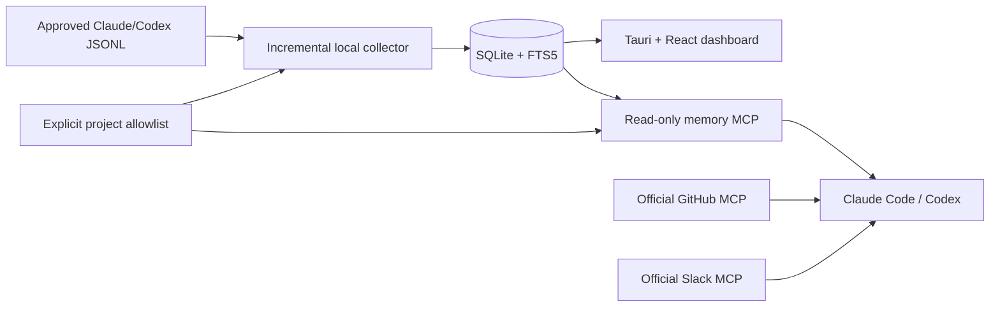

# Architecture

The existing portable C# core owns collection, Git metadata discovery, consent, redaction and SQLite persistence. The Rust Tauri shell owns windows, tray, single-instance wake and a bounded anonymous-pipe backend lifecycle. Keeping the established database/recovery implementation avoids a second incompatible SQLite layer. The standalone C# MCP executable shares the core and pinned SQLite library, without starting a collector or desktop. This is the deliberate deviation from a Rust-only implementation; see [decisions](docs/refactor-decisions.md).

## Local ingestion and consent

`LocalObserver` watches explicitly enabled persisted session roots, tails complete JSONL records in bounded batches and checkpoints byte offsets/fingerprints/turn metadata transactionally with evidence. Startup/resume reconciles available missed messages; the periodic reconciliation enumerates metadata and skips unchanged files. It does not repeatedly parse unchanged history. Events, queues, pending replies, source lines and storage are bounded. No permanent HTTP, Node, Python, model or external-service worker runs.

Git metadata discovery reads bounded local metadata without running Git. Parent workspaces group nested repositories; linked worktrees remain attribution paths. Projects are candidates until explicitly approved. Both ingestion and every public retrieval apply actual working-directory containment against approved roots/repository/worktree paths. A manual label cannot expand access. Broad roots, traversal escapes and reparse paths are denied. Approval is checked again at read time, including existing read-only connections.

Codex admits genuine user messages, `phase=final_answer` and a deduplicated explicit task-completion fallback. Claude holds bounded pending assistant text until a reliable end boundary; `tool_use` discards intermediate text and EOF alone is insufficient. Reasoning, tool outputs, terminal logs and delegated subagent prompts are omitted. Lifecycle events describe the last observed source state; an assistant's ?done? is not independent verification. Cancellation, truncation, rewrite, rotation and pending-final restart recovery are tested.

## Persistence and migration

SQLite WAL, FULL synchronization, transactional record/checkpoint batches, stable IDs and contentless-delete FTS5 preserve restart behavior. SQLite 3.53.4 is used; older unsafe WAL-reset builds are refused. Schema 7 removes remote-service tables, AI caches, derived commitments and their triggers. Historical migrations 1?6 remain solely to recognize/upgrade supported old databases; their services and clients have been deleted.

Existing history is quarantined until explicit approval. Old intermediate/tool/external rows are discarded; available source files are replayed to establish final-response metadata. Original user row identities preserve annotations where possible. Backups use SQLite's online backup API and integrity checking. Purge removes excluded evidence, FTS entries, derived annotations and pending checkpoint text. Original source files and explicit migration/upgrade backups are separate and never silently deleted. OS backups/snapshots and SSD remanence are outside logical purge guarantees.

The desktop has no operating-system credential-store adapter or cleanup command. Native host OAuth/PAT configuration is separate. Historical schema-7 migration metadata remains so existing databases still validate; it does not trigger credential access.

## MCP contract

| Tool | Purpose |
| --- | --- |
| `search_history` | Safe lexical FTS5 queries, bm25 ranking, exact project/source/time narrowing |
| `get_session_digest` | Chronological excerpt pages of user/final messages |
| `get_exchange` | A stable exchange with record and body pagination |
| `get_project_activity` | Bounded session activity/counts and observed lifecycle events |
| `get_session_details` | Approved session/project partitions and collection freshness |

Tools return stable record/source/session/stream/exchange identifiers, original timestamps and source byte offsets. Session details also return approved repository identities and canonical GitHub URLs for cross-source correlation. Source-wide diagnostic text is replaced by a generic coverage flag so excluded filenames cannot leak through an approved session. Stored source text is explicitly labelled untrusted. Tool filters can only narrow operator `--project`, `--source`, `--session`, `--since`, `--until` restrictions. The server rejects incompatible schema without migrating it, uses read-only/query-only connections, admits four calls, applies a 30-second deadline, limits argument and result sizes and disconnects oversized 256 KiB stdio frames without logging their contents. It has no mutation, shell, filesystem-browsing, network or credential tool.

## Native integrations and dashboard

Separate Claude and Codex adapters share one workflow and read-tool list. Claude uses its native plugin manifest, forked skill and an agent with an exact MCP read-tool allowlist. Codex has both a portable manifest/MCP file and a compatibility overlay; explicit native MCP configuration is the tested registration path. External configuration uses only the official servers, GitHub's read-only header/tool subset and Codex's exact enabled-tool lists. Slack has no documented server-wide read-only switch; Claude's restricted reader excludes all write tools. Other host workflows and separately installed plugins retain the permissions the user grants them.

Overview, Projects, Sessions, Timeline, Search and Settings remain. The dashboard has no chat, inference controls, provider tokens or GitHub/Slack collectors. Closing destroys the WebView; the tray collector remains. Quit awaits collector disposal and terminates the owned process tree. Native tests and five-minute idle measurements use isolated synthetic workspaces.

The 0.4.1 dashboard restores a compact authored-PR overview at the user's request. The desktop backend invokes the official `gh api graphql` command with a fixed query for the active viewer's 20 latest open PRs and total count. It has bounded output, a 20-second timeout, process cancellation on shutdown and a five-minute memory cache. There is no network timer, new credential store, database migration or external evidence in MCP. Only URLs from the validated overview can open. The existing official MCP integration remains the path for deeper cross-source reasoning. See [GitHub CLI API documentation](https://cli.github.com/manual/gh_api) and [GitHub user query fields](https://docs.github.com/en/graphql/reference/users).

Dashboard Refresh and wake requests coalesce into the observer's bounded queue. They acknowledge scheduling instead of holding the control RPC open until every history file is reconciled. Live resume already starts catch-up asynchronously. Source freshness reports the work still pending. Timeline explicitly sorts original message timestamps; session ordering still uses last observed activity. Empty Search does not query or display a duplicate timeline.

Desktop 0.4.2 adds the local `collection.stats` RPC with approved-history totals grouped by source/session, message-role counts, current database/write-file size, occupied database pages, storage budget and checkpoint freshness. It returns no conversation text. Overview and the privacy/storage view request it serially every two seconds while visible, without triggering full snapshot refreshes or external calls; navigation, dashboard destruction and document hiding stop the timer. This also shows progress while an initial reconciliation has not yet emitted its completion notification. `host.version` is answered directly by the Rust shell from its package metadata. Neither RPC is exposed by the memory MCP server. No schema or collection scope changes are required.
